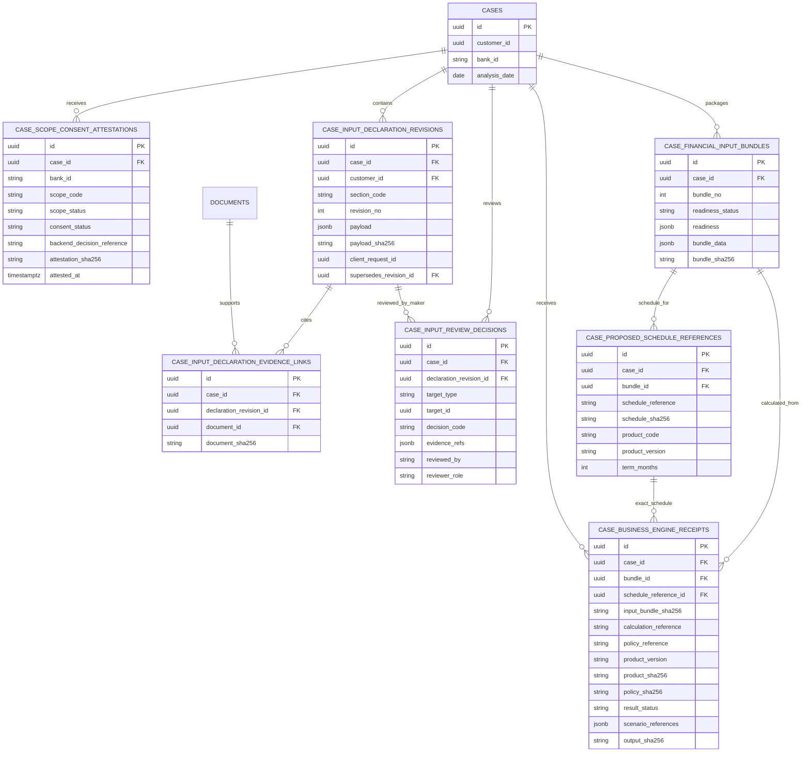

# DATA-AI V10.0 — V18 ERD Additions

The following is the additive DATA-AI V18 data domain. Existing entities from V1–V17 are unchanged.

## Database invariants

- All seven V18 entities are append-only in PostgreSQL: UPDATE/DELETE is rejected by trigger.
- Same-case composite foreign keys protect declaration/evidence and bundle/schedule/receipt relationships.
- Scope attestation bank ID must match the Case bank ID.
- Declaration revisions are sequential by `(case_id, section_code, revision_no)`; client request IDs are unique per case when present.
- `CaseInputReviewDecision.reviewer_role` is `MAKER`; the service checks the signed actor and exact target row/source document.
- A completed Business Engine receipt must reference a schedule row, the same case/bundle/product/version and exactly BASELINE/STRESS_1/STRESS_2 scenario keys.
- All input/output/product/policy/schedule hashes are 64-character lowercase SHA-256 digests.
- V14 Freeze snapshots include the seven V18 tables; a post-receipt change requires a governed successor version before export.

V18 migration path: `db/migration/V18__data_ai_workflow_input_handoff.sql`.
