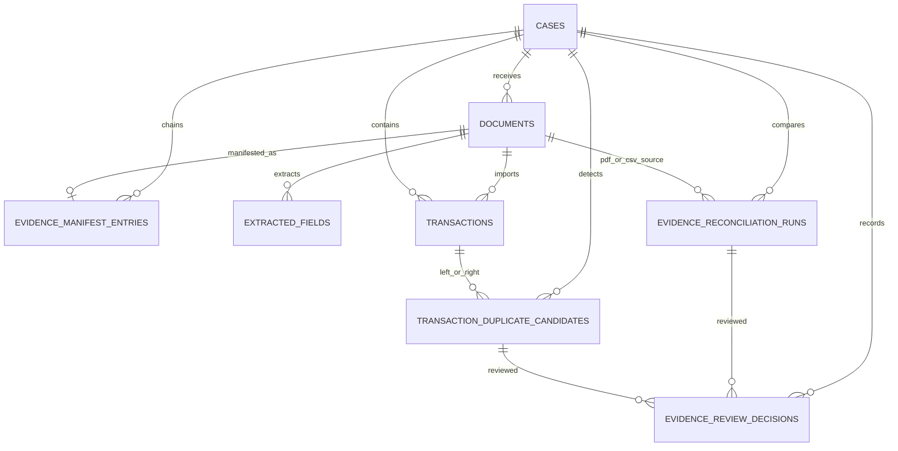

# ERD V9.3.2 – Evidence provenance and reconciliation

## Design rules

- A manifest row is created once per document and chained by case sequence. SHA-256 protects byte-integrity checks; it does not prove origin/authenticity.
- Manifest, duplicate candidate, reconciliation snapshot and review records are append-only at the PostgreSQL trigger boundary.
- Composite foreign keys require referenced documents/transactions to belong to the same case as the record.
- A duplicate candidate links two rows but does not suppress either row.
- A reconciliation run captures both source hashes, selected statement period, totals, tolerance and arithmetic outcome at execution time.
- Review decisions are immutable events with a Maker/admin actor and reason. The latest decision is a display projection; prior decisions remain queryable.
- Backend/Camunda remains the owner for task state, task assignment, Maker ≠ Checker, workflow timers, policy and credit outcomes.
