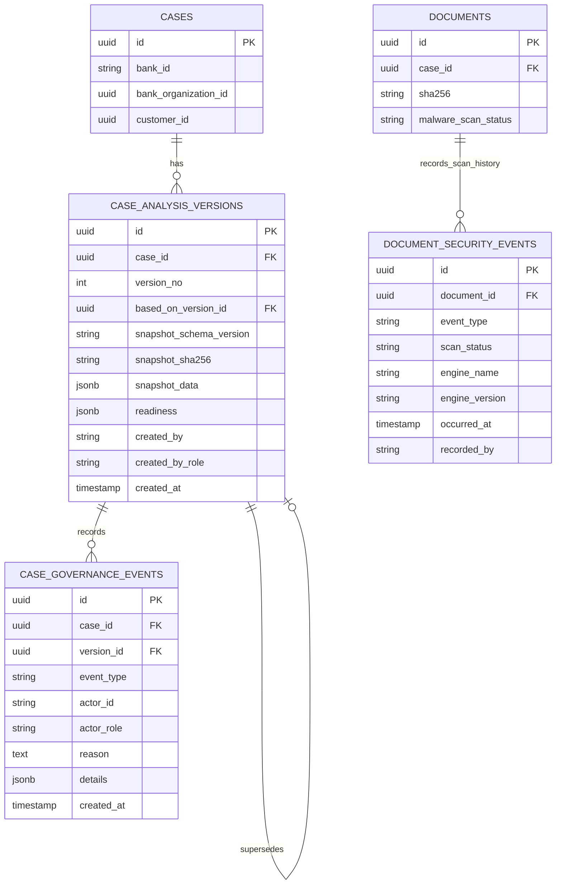

# V9.4.1 Governance ERD

- `case_analysis_versions` is immutable. `based_on_version_id` and `case_id` use a same-case composite foreign key.
- `case_governance_events` is append-only and same-case linked to the version.
- The frozen snapshot includes sanitized `document_security_events`; the V14 freeze guard blocks later security-event inserts until Checker returns the case to Maker. Moving an `extracted_fields.document_id` to a different document is prohibited so a field cannot be moved out of a frozen case.
- Partial unique indexes allow one freeze, one Checker decision and one supersede event per version.
- Checker actor ID must differ from the version Maker. This data layer is not a Camunda task database or credit approval engine.
