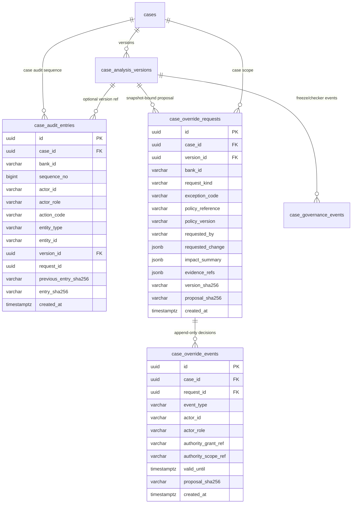

# ERD V9.4.2 – Audit and Override Governance

## Key constraints

- `case_audit_entries`: unique `(case_id, sequence_no)`, previous head must match the latest entry, bank code must match case, append-only.
- `case_override_requests`: same-case composite FK to V14 version; `requested_by` must equal `case_analysis_versions.created_by`; the request's version SHA must equal the stored version hash; unique `(case_id, version_id, proposal_sha256)`; same-case evidence reference trigger; append-only.
- `case_override_events`: same-case request FK; exactly one `REQUESTED`; at most one terminal decision; authority decision is only valid after Checker confirmation and Named Authority actor must differ from Maker and Checker; append-only.

The role/permission catalogue adds `NAMED_AUTHORITY`, `OVERRIDE_APPROVE`, `POLICY_EXCEPTION_APPROVE` and `CASE_GOVERNANCE_AUDIT_VIEW`. Backend/SSO still owns actual grant validation. DATA-AI approval is not applied to a policy engine or credit decision.
