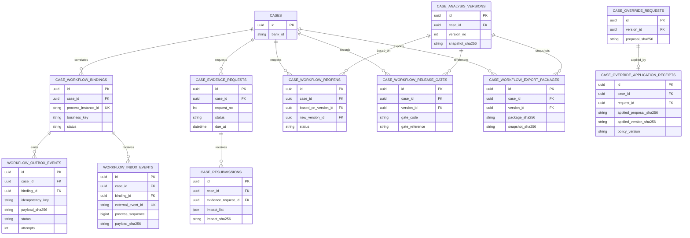

# ERD – DATA-AI V9.5.1 Workflow Integration

V16 adds nine workflow tables. The diagram describes logical relationships; verify deployed PostgreSQL constraints/indexes using Flyway metadata and catalog queries after applying V16. External Camunda, SSO, Business Engine and object-store entities are intentionally not represented as local DATA-AI tables.
