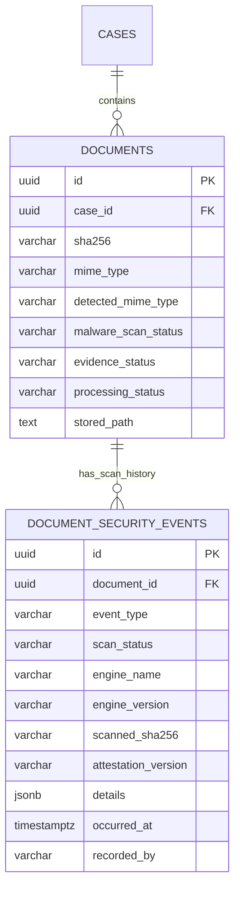

# ERD Additions — V9.5.2

V9.5.2 adds two columns to the existing `document_security_events` entity and database triggers. No new business case tables are introduced. The scanner response also returns the SHA-256 computed over the exact byte stream sent to ClamAV; that digest is compared to the current document row before a trusted verdict is written.

## V17 database invariants

1. `attestation_version=V1_CLAMAV` requires `event_type` and verdict to match, engine `ClamAV`, non-empty engine version and a lowercase SHA-256.
2. The event's `scanned_sha256` must equal the current `documents.sha256` at insert time.
3. A document can change to `CLEAN`/`INFECTED` only after a matching V1_CLAMAV event exists for the same document and hash.
4. A completed scan verdict cannot be reset or changed in place; upload a new immutable document instead.
5. `document_security_events` is append-only.
6. `EXEMPT` remains readable as historical data but new/updated rows cannot use it; legacy rows are not accepted as technical Checker evidence.

The application stores only a reference to platform KMS-managed volume encryption. Actual encryption-at-rest is infrastructure-owned and is not represented as an app-level cryptographic column.
