# Thiết Kế Mô Hình Dữ Liệu & ERD (Entity Relationship Diagram)
**Mã công việc:** KAN-69 (Thuộc KAN-64: Hoàn thiện ERD, API Contract và mô hình dữ liệu)  
**Dự án:** Trợ lý phân tích thu nhập & khả năng trả nợ (Affordability Analysis Assistant - UNIT)  
**Công nghệ:** PostgreSQL 16, Flyway Migration, Spring Boot 3 (Modular Monolith), Hibernate 6 (JPA)  

---

## 1. Tổng quan kiến trúc dữ liệu

Hệ thống thẩm định thu nhập và khả năng trả nợ được thiết kế theo kiến trúc **Modular Monolith** phân chia thành các ranh giới nghiệp vụ (bounded contexts):
- **dossier**: Tiếp nhận hồ sơ vay, lưu trữ chứng từ gốc (evidence lineage) và tính toàn vẹn (SHA-256).
- **statement**: Trích xuất dữ liệu sao kê ngân hàng 6 tháng, đối soát chủ tài khoản (INC 02), phân loại giao dịch (INC 04), neo nguồn gốc dòng/trang (source anchoring - INC 05), điều chỉnh thủ công (INC 06).
- **financial**: Quản lý nghĩa vụ nợ (CIC & tự khai - AFF 03, AFF 04), mô hình tính toán tất định thặng dư tiền mặt ($R$) và hệ số DTI ($Q$), kiểm thử ứng suất (Stress testing 3 kịch bản - AFF 07).
- **shared / audit / workflow**: Lưu vết toàn bộ can thiệp của Maker/Checker (INC 08, AUDIT) và Transactional Outbox đồng bộ với Camunda 8 Zeebe (ARC 04, CAM 04).

---

## 2. Sơ đồ thực thể liên kết (Mermaid ERD)

```mermaid
erDiagram
    dossiers ||--o{ evidence_records : "1 dossier có nhiều chứng từ"
    dossiers ||--o{ statement_accounts : "1 dossier có nhiều tài khoản sao kê"
    statement_accounts ||--o{ transaction_ledger : "1 tài khoản có nhiều giao dịch"
    dossiers ||--o{ transaction_ledger : "truy vấn trực tiếp"
    dossiers ||--o{ obligations : "1 dossier có nhiều nghĩa vụ nợ"
    dossiers ||--o{ affordability_snapshots : "1 dossier có nhiều phiên bản snapshot"
    dossiers ||--o{ audit_logs : "1 dossier có toàn bộ vết kiểm toán"

    dossiers {
        varchar(36) id PK "UUID"
        varchar(64) application_id UK "Mã hồ sơ vay"
        varchar(64) applicant_id "Số CCCD / Mã KH"
        varchar(255) applicant_name "Họ và tên người vay"
        varchar(32) bank_code "Mã ngân hàng tiếp nhận"
        varchar(32) status "DRAFT, PROCESSING, IN_REVIEW..."
        varchar(64) maker_id "Chuyên viên thẩm định"
        varchar(64) checker_id "Kiểm soát viên phê duyệt"
        date analysis_date "Ngày thực hiện phân tích"
        varchar(64) loan_product "Gói vay (Vay tiêu dùng, mua nhà...)"
        numeric(18_2) requested_amount "Số tiền đề nghị vay (VND)"
        int requested_tenor_months "Thời hạn đề nghị vay (tháng)"
        numeric(5_2) proposed_interest_rate "Lãi suất vay đề xuất (%/năm)"
        numeric(18_2) monthly_declared_living_expense "Chi phí sinh hoạt khai báo (VND)"
        timestamptz created_at "Thời điểm tạo"
        timestamptz updated_at "Thời điểm cập nhật"
    }

    evidence_records {
        varchar(36) id PK "UUID"
        varchar(36) dossier_id FK "Liên kết dossiers.id"
        varchar(255) file_name "Tên file gốc"
        varchar(64) file_hash "SHA-256 hash đảm bảo bất biến"
        varchar(32) file_type "BANK_STATEMENT, SALARY_CONFIRMATION..."
        varchar(512) storage_path "Đường dẫn lưu trữ an toàn"
        varchar(32) status "RECEIVED, EXTRACTING, EXTRACTED, FAILED"
        varchar(64) uploaded_by "Người tải lên"
        bigint file_size_bytes "Dung lượng file (bytes)"
        varchar(128) mime_type "Định dạng MIME"
        varchar(32) ocr_status "Trạng thái trích xuất OCR"
        timestamptz ocr_processed_at "Thời điểm OCR hoàn tất"
        timestamptz created_at "Thời điểm tạo"
    }

    statement_accounts {
        varchar(36) id PK "UUID"
        varchar(36) dossier_id FK "Liên kết dossiers.id"
        varchar(128) bank_name "Tên ngân hàng sao kê"
        varchar(32) bank_code "Mã viết tắt ngân hàng (VCB, TCB...)"
        varchar(64) account_number "Số tài khoản ngân hàng"
        varchar(255) account_holder_name "Tên chủ tài khoản in trên sao kê"
        varchar(3) currency "Loại tiền tệ (mặc định VND)"
        date statement_from_date "Từ ngày trong sao kê"
        date statement_to_date "Đến ngày trong sao kê"
        numeric(18_2) total_credit_amount "Tổng tiền ghi có vào tài khoản"
        numeric(18_2) total_debit_amount "Tổng tiền ghi nợ xuất ra"
        boolean is_holder_matched "Khớp tên với CCCD (INC 02)"
        numeric(5_2) match_confidence "Tỉ lệ trùng khớp tên (%)"
        boolean is_verified "Đã xác minh bởi Maker"
        varchar(64) verified_by "Maker ID xác nhận"
        timestamptz verified_at "Thời điểm xác nhận"
        timestamptz created_at "Thời điểm tạo"
        timestamptz updated_at "Thời điểm cập nhật"
    }

    transaction_ledger {
        varchar(36) id PK "UUID"
        varchar(36) account_id FK "Liên kết statement_accounts.id"
        varchar(36) dossier_id FK "Liên kết dossiers.id"
        date transaction_date "Ngày giao dịch"
        date booking_date "Ngày ghi sổ"
        numeric(18_2) amount "Số tiền giao dịch"
        varchar(3) currency "VND"
        varchar(10) direction "CREDIT hoặc DEBIT"
        numeric(18_2) running_balance "Số dư sau giao dịch"
        text description "Nội dung giao dịch gốc"
        varchar(32) classification "SALARY_CANDIDATE, VARIABLE_PAY..."
        numeric(5_2) confidence_score "Độ tin cậy AI phân loại (%)"
        boolean is_recurring_salary "Dấu hiệu lương định kỳ 6 tháng"
        int source_page "Số trang trong file PDF gốc (INC 05)"
        int source_row "Số dòng trong bảng sao kê gốc (INC 05)"
        boolean is_accepted "Chấp nhận tính thu nhập hợp lệ"
        varchar(255) exclusion_reason "Lý do loại trừ"
        numeric(18_2) adjusted_amount "Số tiền Maker điều chỉnh (INC 06)"
        varchar(64) adjusted_by "Maker ID điều chỉnh"
        timestamptz adjusted_at "Thời điểm điều chỉnh"
        text adjustment_reason "Giải trình lý do điều chỉnh"
        timestamptz created_at "Thời điểm tạo"
        timestamptz updated_at "Thời điểm cập nhật"
    }

    obligations {
        varchar(36) id PK "UUID"
        varchar(36) dossier_id FK "Liên kết dossiers.id"
        varchar(255) institution_name "Tên TCTD cấp tín dụng"
        varchar(32) obligation_type "MORTGAGE, UNSECURED_LOAN, CREDIT_CARD..."
        numeric(18_2) monthly_payment "Số tiền phải trả hàng tháng (VND)"
        numeric(18_2) total_balance "Dư nợ còn lại (VND)"
        int remaining_tenor_months "Số tháng còn lại"
        numeric(5_2) interest_rate "Lãi suất (%/năm)"
        varchar(32) source "DECLARED (Tự khai), CIC (Tra cứu)"
        boolean is_duplicated "Đánh dấu trùng lặp giữa tự khai & CIC"
        boolean is_included_in_dti "Tính vào tổng nghĩa vụ nợ DTI"
        text notes "Ghi chú của thẩm định viên"
        timestamptz created_at "Thời điểm tạo"
        timestamptz updated_at "Thời điểm cập nhật"
    }

    affordability_snapshots {
        varchar(36) id PK "UUID"
        varchar(36) dossier_id FK "Liên kết dossiers.id"
        int snapshot_version "Phiên bản tính toán (1, 2, 3...)"
        varchar(32) formula_version "Phiên bản công thức chính sách (V1...)"
        numeric(18_2) eligible_net_income "Thu nhập ròng hợp lệ (I)"
        numeric(18_2) declared_living_expenses "Chi phí sinh hoạt tự khai"
        numeric(18_2) floor_living_expenses "Sàn chi phí tối thiểu theo bank"
        numeric(18_2) effective_living_expenses "Chi phí sinh hoạt áp dụng (E)"
        numeric(18_2) existing_debt_service "Nghĩa vụ nợ hiện tại hàng tháng (D)"
        numeric(18_2) proposed_loan_amount "Số tiền khoản vay đề xuất"
        int proposed_loan_tenor_months "Thời hạn vay đề xuất (tháng)"
        numeric(5_2) proposed_interest_rate "Lãi suất vay đề xuất (%/năm)"
        numeric(18_2) proposed_loan_payment "Nghĩa vụ trả nợ khoản vay đề xuất (P)"
        numeric(18_2) baseline_residual "Thặng dư khả dụng cơ sở: R = I - E - D - P"
        numeric(5_4) baseline_dti "Tỉ lệ DTI cơ sở: Q = (D + P) / I"
        numeric(18_2) stress1_residual "Thặng dư kịch bản Stress 1 (I giảm 20%)"
        numeric(5_4) stress1_dti "Tỉ lệ DTI kịch bản Stress 1"
        numeric(18_2) stress2_residual "Thặng dư Stress 2 (I giảm 20% & E tăng 10%)"
        numeric(5_4) stress2_dti "Tỉ lệ DTI Stress 2"
        numeric(5_4) max_dti_limit "Ngưỡng DTI tối đa (mặc định 0.5000)"
        numeric(18_2) min_residual_limit "Ngưỡng thặng dư tối thiểu (5,000,000 VND)"
        varchar(32) policy_status "PASS, CONDITIONAL, FAIL"
        text policy_notes "Giải trình kết quả thẩm định"
        varchar(64) calculated_by "Người thực hiện tính toán"
        timestamptz created_at "Thời điểm tạo"
    }

    audit_logs {
        varchar(36) id PK "UUID"
        varchar(36) dossier_id FK "Liên kết dossiers.id"
        varchar(64) entity_name "DOSSIER, TRANSACTION, OBLIGATION..."
        varchar(64) entity_id "ID của bản ghi bị tác động"
        varchar(32) action "CREATE, UPDATE, OVERRIDE, APPROVE, REJECT"
        varchar(64) field_name "Tên trường thông tin bị sửa đổi"
        text old_value "Giá trị cũ"
        text new_value "Giá trị mới sau khi can thiệp"
        varchar(64) actor_id "ID người thực hiện"
        varchar(32) actor_role "MAKER, CHECKER, SYSTEM"
        text reason "Lý do bắt buộc khi Maker/Checker can thiệp"
        timestamptz created_at "Thời điểm thao tác"
    }

    outbox_events {
        varchar(36) id PK "UUID"
        varchar(64) aggregate_type "DOSSIER, STATEMENT, FINANCIAL"
        varchar(64) aggregate_id "ID của aggregate root"
        varchar(64) event_type "Tên sự kiện"
        jsonb payload "Nội dung sự kiện dạng JSONB"
        varchar(32) status "PENDING, PROCESSED, FAILED"
        int retry_count "Số lần thử lại"
        timestamptz created_at "Thời điểm tạo"
        timestamptz processed_at "Thời điểm hoàn tất gửi"
    }
```

---

## 3. Danh mục thực thể chi tiết (Data Dictionary)

### 3.1. Phân hệ Quản lý Hồ sơ (`dossier`)
1. **`dossiers`**:
   - Aggregate Root đại diện cho một bộ hồ sơ thẩm định tài chính của khách hàng.
   - Quản lý trạng thái vòng đời (`status`: `DRAFT` $\rightarrow$ `PROCESSING` $\rightarrow$ `IN_REVIEW` $\rightarrow$ `APPROVED` / `REJECTED`).
   - Gắn với Maker (chuyên viên thẩm định) và Checker (kiểm soát viên phê duyệt).
   - Lưu trữ các thông số đề nghị vay: số tiền, kỳ hạn, lãi suất và chi phí sinh hoạt tự khai.

2. **`evidence_records`**:
   - Lưu trữ siêu dữ liệu của toàn bộ chứng từ đính kèm (sao kê ngân hàng, hợp đồng lao động, bảng lương, báo cáo CIC).
   - Cột `file_hash` (SHA-256) đảm bảo tính bất biến và toàn vẹn của chứng từ (INC 01).
   - Theo dõi trạng thái trích xuất dữ liệu OCR (`ocr_status`, `ocr_processed_at`).

### 3.2. Phân hệ Sao kê Tài khoản (`statement`)
1. **`statement_accounts`**:
   - Đại diện cho từng tài khoản ngân hàng xuất hiện trong sao kê.
   - Đảm bảo tính duy nhất qua ràng buộc `UNIQUE(dossier_id, bank_code, account_number)`.
   - Đáp ứng yêu cầu **INC 02**: Kiểm tra tên chủ tài khoản khớp với họ tên người vay (`is_holder_matched`, `match_confidence`).
   - Lưu trữ tổng tiền vào/ra và xác thực bởi Maker.

2. **`transaction_ledger`**:
   - Sổ cái chi tiết toàn bộ các dòng giao dịch trong khoảng thời gian sao kê 6 tháng.
   - **INC 04 (Phân loại thu nhập)**: Cột `classification` chứa các nhãn chuẩn hoá:
     - `SALARY_CANDIDATE`: Giao dịch có dấu hiệu trả lương.
     - `VARIABLE_PAY`: Thu nhập biến đổi (hoa hồng, thưởng, phụ cấp).
     - `REIMBURSEMENT`: Hoàn chi công tác phí/tạm ứng.
     - `TRANSFER`: Chuyển tiền qua lại, người thân gửi.
     - `BORROWING`: Vay mượn từ tổ chức khác hoặc cá nhân.
     - `REVERSAL`: Giao dịch thoái chi, đảo lệnh.
     - `OTHER` / `UNKNOWN`: Khác hoặc chưa xác định.
   - **INC 05 (Source Lineage)**: Cột `source_page` và `source_row` neo vị trí chính xác đến từng trang và từng dòng trong tài liệu sao kê gốc để kiểm toán viên có thể nhấp vào xem trực tiếp chứng từ.
   - **INC 06 (Maker Override)**: Maker có quyền điều chỉnh số tiền (`adjusted_amount`), loại trừ giao dịch (`is_accepted = false`, `exclusion_reason`) và bắt buộc ghi nhận lý do (`adjustment_reason`).

### 3.3. Phân hệ Phân tích Tài chính (`financial`)
1. **`obligations`**:
   - Quản lý các khoản nợ định kỳ của khách hàng (thẻ tín dụng, vay tín chấp, vay mua nhà...).
   - **AFF 03 & AFF 04**: Ghi nhận từ 2 nguồn `source = 'DECLARED'` (khách hàng tự khai) và `source = 'CIC'` (tra cứu CIC).
   - Hỗ trợ đánh dấu loại trừ khoản nợ trùng lặp (`is_duplicated = true`) để không tính trùng vào nghĩa vụ nợ $D$.

2. **`affordability_snapshots`**:
   - Bản chụp bất biến có đánh số phiên bản (`snapshot_version`) lưu trữ toàn bộ dữ liệu đầu vào và kết quả công thức tính toán.
   - Công thức quy định:
     $$E = \max(\text{declared\_living\_expenses}, \text{floor\_living\_expenses})$$
     $$R_{\text{base}} = I - E - D - P$$
     $$Q_{\text{base}} = \frac{D + P}{I}$$
   - Lưu trữ kết quả kiểm thử ứng suất (**AFF 07**):
     - **Stress 1**: Thu nhập ròng $I$ giảm $20\%$ ($0.8 \times I$).
     - **Stress 2**: Thu nhập ròng $I$ giảm $20\%$ và chi phí sinh hoạt $E$ tăng $10\%$ ($0.8 \times I$ và $1.1 \times E$).
   - Đánh giá trạng thái chính sách tín dụng: `PASS`, `CONDITIONAL`, hoặc `FAIL`.

### 3.4. Phân hệ Bổ trợ & Kiểm toán (`shared`)
1. **`audit_logs`**:
   - Ghi vết mọi thao tác can thiệp thủ công của Maker và Checker: giá trị cũ (`old_value`), giá trị mới (`new_value`), người thực hiện (`actor_id`, `actor_role`), thời điểm (`created_at`) và lý do giải trình bắt buộc (`reason`).
2. **`outbox_events`**:
   - Triển khai **Transactional Outbox Pattern** đảm bảo gửi tin cậy các sự kiện nghiệp vụ tới Camunda 8 Zeebe và các service vệ tinh khác mà không gây lỗi phân tán (distributed transaction failure).

---

## 4. Ràng buộc toàn vẹn & Chiến lược chỉ mục (Indexing Strategy)

1. **Khóa chính**: Tất cả các bảng sử dụng kiểu chuỗi UUIDv4 cố định độ dài 36 ký tự (`VARCHAR(36)`), đảm bảo tính phân tán và không làm lộ số lượng hồ sơ.
2. **Khóa ngoại & Cascade**:
   - Mọi bảng con liên kết với `dossiers(id)` thông qua ràng buộc `ON DELETE CASCADE`.
   - Bảng `transaction_ledger` liên kết đồng thời với `statement_accounts(id)` và `dossiers(id)` để tối ưu hóa truy vấn tổng hợp cấp hồ sơ.
3. **Độ chính xác tiền tệ**:
   - Toàn bộ giá trị tiền tệ VND sử dụng kiểu dữ liệu `NUMERIC(18, 2)` (hoặc `BigDecimal` trong Java), tuyệt đối không dùng kiểu dấu phẩy động (`FLOAT`, `DOUBLE`) để ngăn chặn sai số tích luỹ.
   - Hệ số nợ $Q$ (DTI) sử dụng `NUMERIC(5, 4)` để lưu chính xác 4 chữ số thập phân (ví dụ: `0.4500` tương đương `45.00%`).
   - Tỷ lệ phần trăm lãi suất và điểm tin cậy sử dụng `NUMERIC(5, 2)`.
4. **Chỉ mục truy vấn (Indexes)**:
   - Composite Index `idx_trans_ledger_date` trên `(dossier_id, transaction_date)` để phục vụ sắp xếp thời gian sổ cái 6 tháng.
   - Composite Index `idx_trans_ledger_classification` trên `(dossier_id, classification)` để tăng tốc độ lọc và tính tổng thu nhập theo nhóm lương.
   - Composite Index `idx_snapshots_dossier_version` và `UNIQUE(dossier_id, snapshot_version)`.
   - Index trên `dossiers(applicant_id)` và `dossiers(status)`.
   - Composite Index `idx_outbox_status_created_at` trên `(status, created_at)` phục vụ polling job gửi event tới Camunda Zeebe.

---

## 5. Quy trình Migration bằng Flyway

- File migration `V1__init_schema.sql`: Khởi tạo bảng nền tảng `dossiers`, `evidence_records`, `outbox_events`.
- File migration `V2__complete_erd_schema.sql`: Hoàn thiện bảng `statement_accounts`, `transaction_ledger`, `obligations`, `affordability_snapshots`, `audit_logs` cùng đầy đủ các cột mở rộng, ràng buộc và chỉ mục.
- Kiểm thử tự động với Spring Data JPA: Toàn bộ 9/9 unit tests và entity mapping tests đã được kiểm chứng thành công trên môi trường local.
